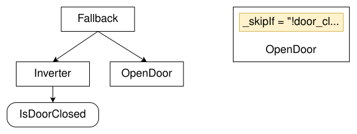
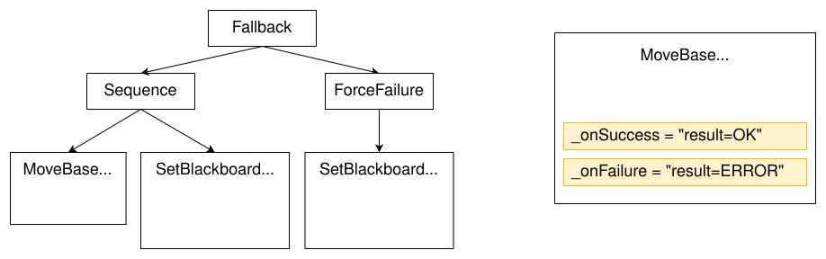
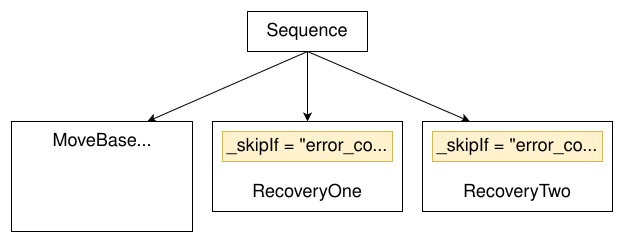
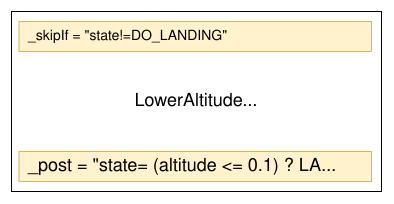

# Pre and Post conditions

Leveraging the power of the scripting language
introduced in the [previous tutorial](guides/scripting.md),
BT.CPP 4.x introduces the concept of Pre and Post Conditions,
i.e scripts that can run either before or after the actual 
__tick()__ of a Node.

Pre and Post conditions are supported by __all__ the nodes and
 don't need any modifications in your C++ code.

:::caution
The goal of scripting is __not__ to write complex code,
but only to improve the readability of the tree and 
reduce the need for custom C++ Nodes in very simple 
use cases.

If your scripts become too long, you may want to 
reconsider your decision to use them.
:::

## Pre conditions

| Name | Description | When Evaluated |
|-------------|---------|----------------|
| **_skipIf**    |  Skip the execution of this Node, if the condition is true   | IDLE only (once) |
| **_failureIf** |  Skip and return FAILURE, if the condition is true | IDLE only (once) |
| **_successIf** |  Skip and return SUCCESS, if the condition is true | IDLE only (once) |
| **_while**     |  If false when IDLE, skip. If false when RUNNING, halt the node and return SKIPPED. | IDLE and RUNNING (every tick) |
| **_onlyIf**    |  Skip the execution of this Node, if the condition is false (the opposite of `_skipIf`) | IDLE only (once) |
| **_onStart**   |  Not a condition: execute this script right before the Node starts | IDLE only (once) |

:::info Since 4.11
`_onlyIf` and `_onStart` were added in BT.CPP 4.11.
Older versions (4.10 and earlier) **silently ignore** attributes starting with `_`
that they don't know: the tree loads without errors, but `_onlyIf` never skips
the node and the `_onStart` script is never executed.
A tree that uses them must run on BT.CPP 4.11 or later.
:::

:::caution Important: One-time vs. Continuous Evaluation
**`_skipIf`, `_failureIf`, `_successIf`, `_onlyIf` and `_onStart` are evaluated only once** when the node
transitions from IDLE to another state. They are **NOT re-evaluated** while the node
is RUNNING.

Only **`_while`** is checked on every tick, including while the node is running.

If you need a condition to be checked on every tick, use `_while` or a `ReactiveSequence`
(see [below](#checking-a-condition-on-every-tick)).
:::

:::note Evaluation Order
Pre conditions are evaluated in this order: `_failureIf` -> `_successIf` -> `_skipIf` -> `_while` -> `_onlyIf` -> `_onStart`.
The first condition that is satisfied will determine the result.
`_onStart` comes last, so its script is executed only if none of the
conditions before it returned a status.
:::

### Example

In previous tutorials, we saw how to build an if-then-else
logic in the tree using a fallback.

The new syntax is much more compact:



Previous approach:

``` xml
<Fallback>
    <Inverter>
        <IsDoorClosed/>
    </Inverter>
    <OpenDoor/>
</Fallback>
```

If, instead of using a custom ConditionNode __IsDoorOpen__,
we can store a boolean in an entry called `door_closed`, the XML can be rewritten as:

``` xml
<OpenDoor _skipIf="!door_closed"/>
```

### `_onlyIf` and `_onStart`

`_onlyIf="condition"` is equivalent to `_skipIf="!condition"`, and often easier to read.
The previous example becomes:

``` xml
<OpenDoor _onlyIf="door_closed"/>
```

- Like `_while`, it skips a node that is IDLE when the condition is false. Unlike `_while`,
  it is **not** checked again while the node is RUNNING, so it never halts a running node.
- If a node has both `_skipIf` and `_onlyIf`, either one can skip it: the node is executed
  only if `_skipIf` is false **and** `_onlyIf` is true.

`_onStart` is not a condition, but a script: its result is ignored and it never changes the
status of the Node. Use it to initialize or reset blackboard entries when a Node starts:

``` xml
<MoveBase goal="{target}"
          _onStart="arrived := false"
          _onSuccess="arrived := true"/>
```

- It is executed when the Node starts from IDLE, right before its first __tick()__,
  and only if no other pre condition skipped the Node or returned a status.
  Unlike a `<Script>` placed before the Node in a Sequence, it is skipped together with the Node.
- It is not executed again while the Node is RUNNING (`_while`, instead, is evaluated on every tick).
- It is executed __every time__ the Node starts from IDLE, not once per execution of the tree:
  after a halt, at every iteration of `RetryUntilSuccessful` or `Repeat` and, in a
  `ReactiveSequence`, on every tick for the children that come before the RUNNING one
  (they are halted and ticked again from IDLE).
- It runs after the other pre conditions, so they don't see what it writes when the Node starts:
  if `done` is false, `<MyAction _skipIf="done" _onStart="done := true"/>` is executed.
- A pre-tick callback, such as the ones used by Groot2 for breakpoints and fault injection,
  may still replace the __tick()__ of the Node after `_onStart` was executed.
- Like the other pre conditions, it is ignored by `ThreadedAction`, which doesn't evaluate
  pre and post conditions.

### Checking a condition on every tick

The inline `_successIf` below is evaluated once, when `MoveToGoal` transitions from IDLE.
If `battery_ok` changes while `MoveToGoal` is RUNNING, the change is ignored.

``` xml
<MoveToGoal _successIf="battery_ok"/>
```

The `<Precondition>` decorator node doesn't change this: it evaluates `if` only while its
child isn't RUNNING. Once the child returns RUNNING, the condition is not checked again
until the child completes. With `else="RUNNING"`, it returns RUNNING while the condition
is false, so it **waits** for the condition before starting the child:

``` xml
<!-- Waits until battery_ok is true, then runs MoveToGoal to the end -->
<Precondition if="battery_ok" else="RUNNING">
    <MoveToGoal/>
</Precondition>
```

To **stop** a running node as soon as a condition becomes false, use `_while`,
that halts the node and returns SKIPPED:

``` xml
<MoveToGoal _while="battery_ok"/>
```

or check the condition before the node in a `ReactiveSequence`, that halts the
running child and returns FAILURE:

``` xml
<ReactiveSequence>
    <ScriptCondition code="battery_ok"/>
    <MoveToGoal/>
</ReactiveSequence>
```

## Post conditions

| Name | Description |
|-------------|---------|
| **_onSuccess** | Execute this script, if the Node returned SUCCESS |
| **_onFailure** | Execute this script, if the Node returned FAILURE  |
| **_post**      | Execute this script, if the Node returned either SUCCESS or FAILURE |
| **_onHalted**  | Script executed if a RUNNING Node was halted |


### Example

In a [tutorial about subtrees](tutorial-basics/tutorial_06_subtree_ports.md),
 we saw how a specific blackboard variable was written based on the result
 of __MoveBase__. 

On the left side, you can see how this logic would be
implemented in BT.CPP 3.x and how much simpler it is to use post conditions instead.
Additionally, the new syntax supports **enums**.



Previous version:

``` xml
<Fallback>
    <Sequence>
        <MoveBase  goal="{target}"/>
        <SetBlackboard output_key="result" value="0" />
    </Sequence>
    <ForceFailure>
        <SetBlackboard output_key="result" value="-1" />
    </ForceFailure>
</Fallback>
```

New implementation:

``` xml
<MoveBase goal="{target}" 
          _onSuccess="result:=OK"
          _onFailure="result:=ERROR"/>
```

# Design pattern: error codes

One of the areas where Behavior Trees may struggle, when 
compared to State Machines, is in those patterns where
a different strategy should be executed based on the 
result of an Action. 

Since BTs are limited to SUCCESS and FAILURE, that could 
be unintuitive.

A solution is storing the __result / error code__ in the
blackboard, but that was cumbersome in version 3.X.

Pre conditions can help us implement more readable code, like this one:



In the tree above, we added an Output port __return__ to
__MoveBase__ and we conditionally take the second or third branch
of the Sequence based on the value of `error_code`.

# Design pattern: states and declarative trees

Even if the promise of Behavior Tree is to free us from 
the tyranny of states, but the truth is that sometimes it is
hard to reason about our application without states.

Using states can make our Tree easier. For instance, we can 
take a certain branch of the tree only when the robot
(or a subsystem) is in a particular state.

Consider this Node and its pre/post conditions:



This node will be executed only if the state is equal to **DO_LANDING** and, once the value of `altitude` is small
enough, the state is changed to **LANDED**.

Note as DO_LANDING and LANDED are enums, not strings

:::tip
A surprising side effect of this pattern is that we made our
Node more __declarative__ i.e. it is easier to move this specific Node/Subtree into a different portion of the tree.
:::
